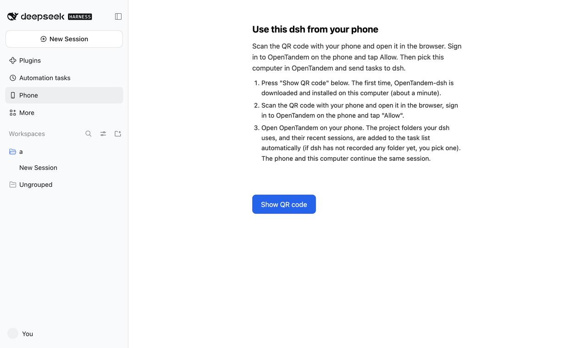
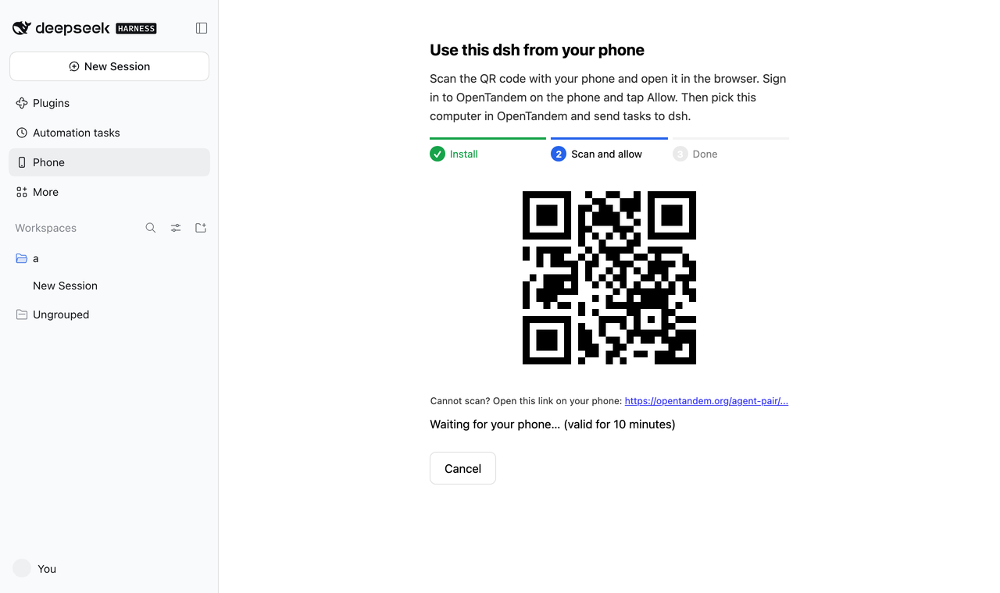
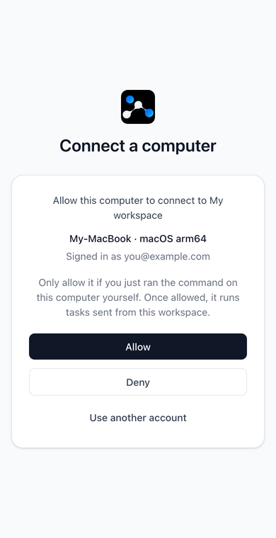
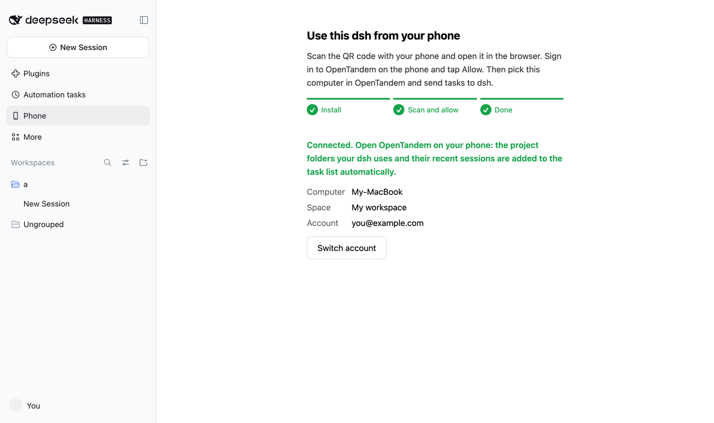
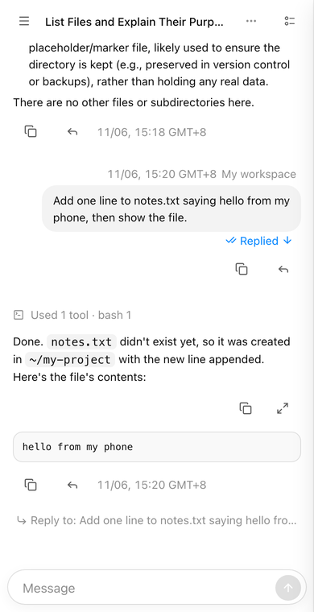

# dsh-phone

Use [DeepSeek Harness](https://github.com/deepseek-ai/deepseek-harness) (`dsh`) from your phone. Scan a QR code in `dsh web`, sign in to [OpenTandem](https://opentandem.org) on the phone, tap **Allow**, and send tasks to the computer that runs `dsh`. Your existing `dsh` sessions show up on the phone, and the phone and the computer continue the same session.

[中文说明](README.zh-CN.md)

## Install

From npm:

```sh
dsh plugin --profile web add dsh-phone
```

From GitHub:

```sh
dsh plugin --profile web add github:opentandem/dsh-phone
```

You can also open **Plugins → Add plugin** in `dsh web`, enter `dsh-phone`, install it and press **Enable now**. If the **Phone** entry does not appear in the sidebar, refresh the page once.

## Use

1. Click **Phone** in the `dsh web` sidebar and press **Show QR code**.

   

2. Scan the code with your phone and open it in the browser.

   

3. Sign in to OpenTandem on the phone and tap **Allow**.

   

4. The page in `dsh web` shows that the computer is connected.

   

5. Open OpenTandem on the phone. The project folders that `dsh` uses and their recent sessions are added to the task list, and you can continue them or start new ones.

   

To connect another account, press **Switch account** on the page. The current connection stays until you tap **Allow** on the phone.

## What it installs and sends

This plugin is a small page and a pairing step. The part that keeps the phone connected is the OpenTandem command line, which is a separate program, so you should know what it does before you press **Show QR code**:

| What | Details |
|---|---|
| Download | The first time, the plugin downloads the launcher from `https://opentandem.org/api/cli-script?file=launcher.mjs` to `~/.opentandem-dsh/` and runs it on the Node.js that runs `dsh`. The launcher installs the OpenTandem command line, which takes about a minute. |
| Background service | The command line starts a background Runner that stays installed, so the phone can reach this computer after `dsh web` is closed. Remove it with `opentandem uninstall`, or remove the computer in the OpenTandem settings. |
| What the phone can do | After you tap **Allow**, tasks sent from that OpenTandem account run on this computer through `dsh`. Allow it only if you started the pairing yourself. |
| Accounts | You sign in on the phone, so this plugin never sees your OpenTandem account or password. It does not use your DeepSeek account. Tasks use the models you have already set up in `dsh`. |
| Connection check | Every route of this plugin sits behind the connection check that `dsh` uses for its own APIs, and the POST routes only accept `application/json`. |

The source of the [OpenTandem Runner and command line](https://github.com/opentandem/opentandem) is public under AGPL-3.0.

## Configuration

| Environment variable | Meaning |
|---|---|
| `OPENTANDEM_CLI` | Use this launcher or `opentandem` executable instead of downloading one. |
| `OPENTANDEM_SERVER` | The OpenTandem server to download from and pair with. The default is `https://opentandem.org`. |

## Compatibility

This plugin has been tested on macOS with `dsh` 0.2.1-rc.2 and 0.2.2-rc.1. Windows and Linux have not been tested yet.

## About OpenTandem

**OpenTandem is a unified workspace for individuals and teams that manages multiple AI coding agents, with mobile access.**
**One workspace, all your machines, with agent switching, model routing, live quota tracking, and team collaboration.**

## License

MIT. The OpenTandem command line and Runner are separate AGPL-3.0 programs that this plugin only starts as a child process, and none of their code is bundled here.
